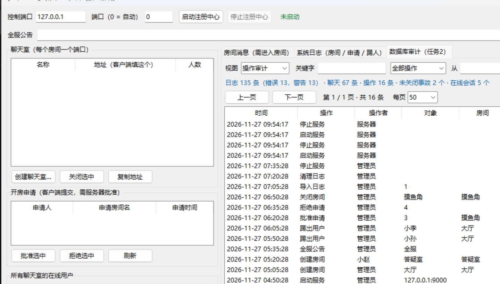
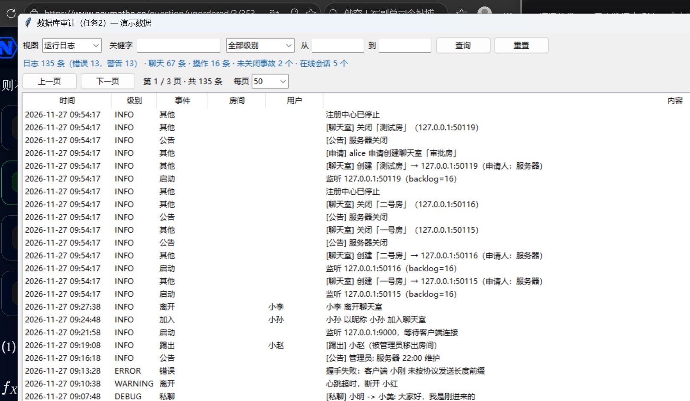
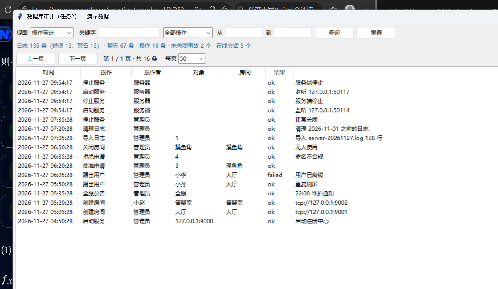
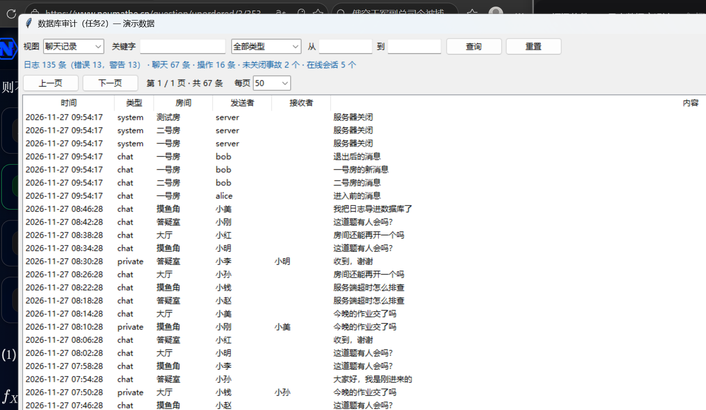
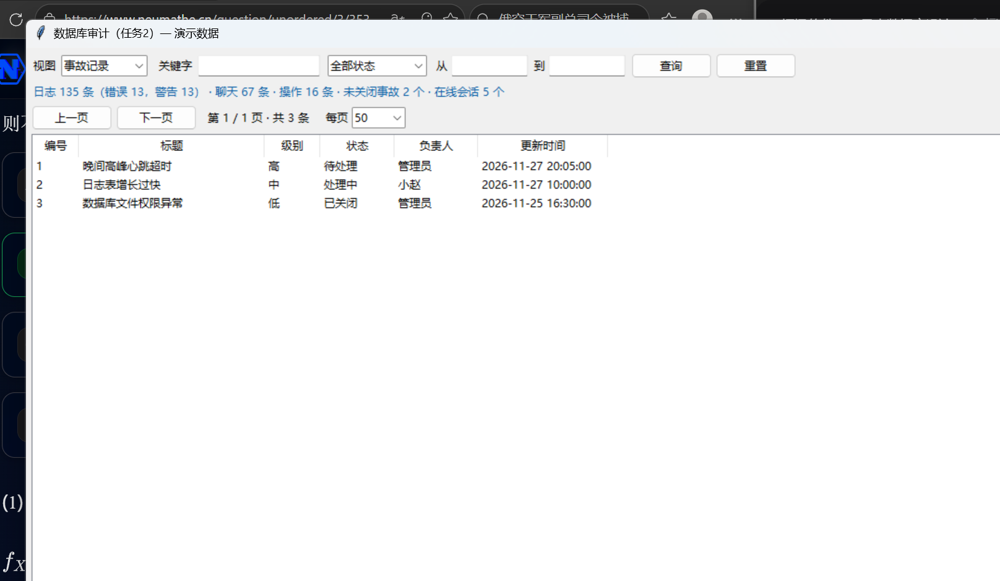

# 任务 2 设计报告：聊天服务器运维日志管理系统

> 课程：挑战课题—Python 编程　班级：______　学号：______　姓名：______
> 说明：本报告的全部运行结果均来自仓库内实际执行的命令，命令与关键输出见 `docs/DEVLOG.md`；
> 项目在 AI 编码助手（DeepSeek Harness）辅助下完成，方案讨论与代码审查由本人确认。

## 1. 设计思路

### 1.1 选题

任务 2 要求用 `sqlite3` 实现一个可浏览、排序、增删改查的微型管理信息系统。直接做"学生管理"
与任务 1 的成果没有关系，于是把它与任务 1 的**多聊天室通讯软件**结合：

> **把聊天服务器产生的运行日志、房间/用户/会话、管理员操作、聊天消息与故障事故统一存进
> SQLite，并在服务器监控台里直接查询。**

这样既满足任务 2 的全部强制要求，又让任务 1 从"能聊天"升级为"可运维"：出问题能查、能追责、
能复盘。

### 1.2 难点与取舍

| 难点 | 取舍 |
| --- | --- |
| 日志量大、聊天不能等写库 | 写库走独立守护线程 + 队列批量事务；数据库故障只降级，不阻塞聊天（fail-open） |
| 任务 1 已有 `logging` 体系 | 用自定义 `logging.Handler` 全量接日志，不改原有日志调用 |
| 房间/用户/会话需要结构化字段 | hub 增加 `on_room_created/on_room_closed/on_room_activity` 回调，与日志通路互补 |
| 旧日志文件也要能查 | 提供 `importer.py`，兼容两种时间格式，无法识别的行按 INFO 原文入库，不丢行 |
| 报告、答辩需要看得见 | 监控台新增"数据库审计（任务2）"标签页，同时提供命令行界面 |

## 2. 架构与模块

```text
任务1 聊天服务器（src/task1_socket_chat/）
  ChatServer / ChatHub / GUI 监控台
        │  logging 记录                       │ hub 回调
        ▼                                     ▼
  QueueLogHandler ──► queue.Queue ──► AuditRecorder 写线程
                                     │ init_db / 批量事务
                                     ▼
                          data/chat_ops.db (SQLite, WAL)
                                     ▲
         ┌───────────────────────────┼──────────────────────────┐
   Repository / stats          importer.py                cli.py
   （参数化查询、白名单排序）    （历史 .log 导入）        （字符界面 MIS）
                                     ▲
                          AuditPanel（Tk 标签页）
```

### 2.1 文件清单

| 文件 | 职责 |
| --- | --- |
| `src/task2_db_system/config.py` | 路径、分页、枚举与中文标签常量 |
| `src/task2_db_system/schema.sql` | 建表 DDL、索引、CHECK 约束 |
| `src/task2_db_system/db.py` | 连接（WAL / 外键 / busy_timeout）、建库、事务上下文 |
| `src/task2_db_system/repository.py` | 所有增删改查；排序字段白名单；LIKE 转义；分页 |
| `src/task2_db_system/stats.py` | 概览、级别/事件/动作分布、小时趋势、活跃房间、事故统计 |
| `src/task2_db_system/recorder.py` | 日志 Handler、写线程、批量事务、房间/用户/会话映射 |
| `src/task2_db_system/importer.py` | 历史文本日志导入 |
| `src/task2_db_system/seed.py` | 固定种子（20261127）的演示数据，可重复重建 |
| `src/task2_db_system/cli.py` | 九项菜单的字符界面 + `--demo/--stats` |
| `src/task1_socket_chat/audit_panel.py` | 监控台内的四个查询视图与事故增删改 |
| `src/task1_socket_chat/gui_server.py` | 接线：启动/停止记录器、操作审计、`--db` 参数 |

## 3. 数据库设计

### 3.1 表结构

| 表 | 作用 | 关键字段与约束 |
| --- | --- | --- |
| `server_instance` | 每次服务端运行 | `host/port/protocol/started_at/stopped_at` |
| `chat_room` | 房间档案 | `instance_id → server_instance`，`UNIQUE(instance_id, hub_room_id)`，`closed_at/close_reason` |
| `chat_user` | 用户档案 | `nickname UNIQUE`，`first_seen/last_seen` |
| `user_session` | 进出房间会话 | `room_id/user_id` 外键，`CHECK(left_at IS NULL OR left_at >= joined_at)` |
| `log_event` | 运行日志 | `level CHECK(DEBUG…CRITICAL)`，`event_type`，`instance_id` 可空（兼容历史导入） |
| `operation` | 管理员操作审计 | `action CHECK(枚举)`，`result CHECK(ok/failed)` |
| `chat_message` | 聊天正文 | `kind CHECK(chat/private/system)`，`room_id ON DELETE SET NULL` |
| `incident` | 故障事故 | `severity CHECK(低/中/高)`，`status CHECK(待处理/处理中/已关闭)`，关联日志/操作 |

索引覆盖时间、级别、事件类型、动作、房间、发送者、事故状态等常用筛选列。

### 3.2 关键 DDL 片段（节选）

```sql
CREATE TABLE IF NOT EXISTS chat_message (
    id          INTEGER PRIMARY KEY AUTOINCREMENT,
    instance_id INTEGER REFERENCES server_instance(id) ON DELETE SET NULL,
    room_id     INTEGER REFERENCES chat_room(id) ON DELETE SET NULL,
    ts          TEXT    NOT NULL,
    kind        TEXT    NOT NULL CHECK (kind IN ('chat', 'private', 'system')),
    sender      TEXT    NOT NULL DEFAULT '',
    recipient   TEXT    NOT NULL DEFAULT '',
    content     TEXT    NOT NULL DEFAULT '',
    content_len INTEGER NOT NULL DEFAULT 0
);

CREATE TABLE IF NOT EXISTS operation (
    id          INTEGER PRIMARY KEY AUTOINCREMENT,
    instance_id INTEGER REFERENCES server_instance(id) ON DELETE SET NULL,
    ts          TEXT    NOT NULL,
    action      TEXT    NOT NULL CHECK (action IN (...)),
    actor       TEXT    NOT NULL DEFAULT '服务器',
    target      TEXT    NOT NULL DEFAULT '',
    room_name   TEXT    NOT NULL DEFAULT '',
    result      TEXT    NOT NULL DEFAULT 'ok' CHECK (result IN ('ok', 'failed')),
    detail      TEXT    NOT NULL DEFAULT ''
);

CREATE INDEX IF NOT EXISTS idx_msg_ts ON chat_message (ts);
```

建库脚本幂等（`CREATE ... IF NOT EXISTS` + `schema_meta` 版本行），WAL 模式下读写互不阻塞。

### 3.3 参数化与安全

- 所有 SQL 一律 `?` 占位，包含用户输入的关键字（`LIKE` 中的 `%`/`_`/`\` 会转义）。
- 排序字段只能取自 `SORTABLE_*` 白名单，非法值抛 `ValueError`，从根上杜绝注入。
- 批量写入统一走 `with transaction(conn):`，失败整批回滚。
- 删除事故、清理日志前都要二次确认；清理日志必须提供到秒的时间戳。

## 4. 核心实现

### 4.1 三条数据通路

1. **日志通路**：`QueueLogHandler` 挂在 `task1` logger 上，`emit` 只入队；写线程按 0.5 s / 200 条
   批量落库，并按关键字推断事件类型（加入/离开/踢出/公告/错误……）。
2. **结构化通路**：hub 在创建/关闭房间、每个房间消息时回调 `AuditRecorder`，直接写
   `chat_room`、`chat_message`、`user_session`，不再依赖日志文本。
3. **历史导入**：`importer.py` 解析 `YYYY-MM-DD HH:MM:SS,mmm LEVEL msg` 与 `HH:MM:SS LEVEL msg`
   两种前缀，逐 200 行一个事务。

### 4.2 fail-open

`AuditRecorder.start()` 在后台线程里建库；任何异常都只置 `enabled = False` 并打印一条错误，
聊天功能继续工作。写库批次失败也只记 `dropped/errors` 计数，不向聊天线程抛异常。

### 4.3 GUI 集成

监控台第三个标签页"数据库审计（任务2）"提供四个视图：运行日志、操作审计、聊天记录、事故记录。
支持关键字、级别/动作/类型/状态筛选、日期范围、表头点击排序、分页、导出 CSV，事故记录支持
新增/编辑/删除。服务端启动时自动开记录器，停止时先关房间、再停写线程，保证退出前的消息也落库。

### 4.4 命令行界面

`python -m src.task2_db_system.cli` 提供九项菜单：浏览日志/聊天/操作/事故、统计概览、基础数据、
导入、导出 CSV、清理日志；所有输入都有默认值与非法输入保护，`0` 或空行退出。

## 5. 运行结果

> 以下命令均在仓库根目录执行；Python 为 3.12.14（另在 3.7 语法层面保持兼容）。

### 5.1 建库与演示数据

```text
python -m src.task2_db_system.seed --reset
演示数据已写入 F:\codex,ultilize\python-challenge\data\chat_ops.db
server_instance 1 / chat_room 3 / chat_user 8 / user_session 8
log_event 120 / chat_message 60 / operation 12 / incident 3
```

### 5.2 命令行演示

```text
python -m src.task2_db_system.cli --demo
```

输出运行日志、聊天记录、操作审计、事故记录各 5 条及统计概览（日志 120 条，其中错误 13、
警告 13；聊天消息 60 条；操作 12 条；事故 3 条，未关闭 2 条；级别分布、24 小时趋势等）。

### 5.3 服务器监控台内的审计面板



*图 1　"数据库审计（任务2）"作为监控台第三个标签页，与房间、系统日志并列。*



*图 2　运行日志：按级别/事件/房间/用户筛选，表头排序，分页。*



*图 3　操作审计：开始/停止服务、创建/关闭房间、批准/拒绝申请、踢人、公告、导入、清理等。*



*图 4　聊天记录：聊天、私聊、系统消息全部入库，可按房间与发送者查询。*



*图 5　事故记录：支持新增、编辑、删除，并可关联到具体日志/操作。*

### 5.4 测试

```text
python -m unittest tests.test_task2_db tests.test_task2_recorder tests.test_task2_cli
Ran 26 tests in 0.855s
OK
```

测试覆盖建表约束、LIKE 转义、排序白名单、分页、事故 CRUD、会话生命周期、日志分类、
消息/会话落库、数据库不可用时的降级、历史日志导入与 CLI 冒烟。

### 5.5 GUI 端到端冒烟

以真实 `MonitorApp` 启动注册中心 → 创建房间 → 全服公告 → 关闭房间 → 停止，再查库：

```text
tables: {'server_instance': 1, 'chat_room': 1, 'chat_message': 2, 'log_event': 7, 'operation': 2}
rooms:  [('冒烟房间', '2026-11-27 09:54:47', '冒烟测试结束')]
messages: [('system', '冒烟公告：系统消息也会入库'), ('system', '冒烟测试结束')]
SMOKE OK
```

## 6. 问题与改进

| 问题 | 处理 |
| --- | --- |
| `NOT NULL` 冲突：历史导入没有运行实例 | 将 `log_event.instance_id`、`operation.instance_id` 改为可空 |
| `purge_logs("2026-11-27")` 未被拒绝 | 在补全时间之前先校验原始字符串必须含时分秒 |
| 排序键随视图切换残留，弹"不支持按 ts 排序" | 刷新时校验排序键是否属于当前视图，否则回退默认排序 |
| 程序化切换视图后表头不刷新 | 记录已应用的视图，刷新时自动重建列与筛选项 |
| 演示数据写入违反 CHECK/UNIQUE | 未结束字段用 `NULL`、`leave_reason` 用空串、昵称先查后插 |
| Windows 下临时目录建库被沙箱拒绝 | 测试库改为 `data/` 下唯一文件名，用完关闭连接再删 |

后续可做：日志表按时间分区归档、支持 MySQL 后端、把审计面板做成独立窗口、增加导出 Excel。

## 7. 附：完整源码清单

```text
src/task2_db_system/__init__.py      src/task2_db_system/config.py
src/task2_db_system/schema.sql       src/task2_db_system/db.py
src/task2_db_system/repository.py    src/task2_db_system/stats.py
src/task2_db_system/recorder.py      src/task2_db_system/importer.py
src/task2_db_system/seed.py          src/task2_db_system/cli.py
src/task1_socket_chat/audit_panel.py
tests/test_task2_db.py               tests/test_task2_recorder.py
tests/test_task2_cli.py
```
